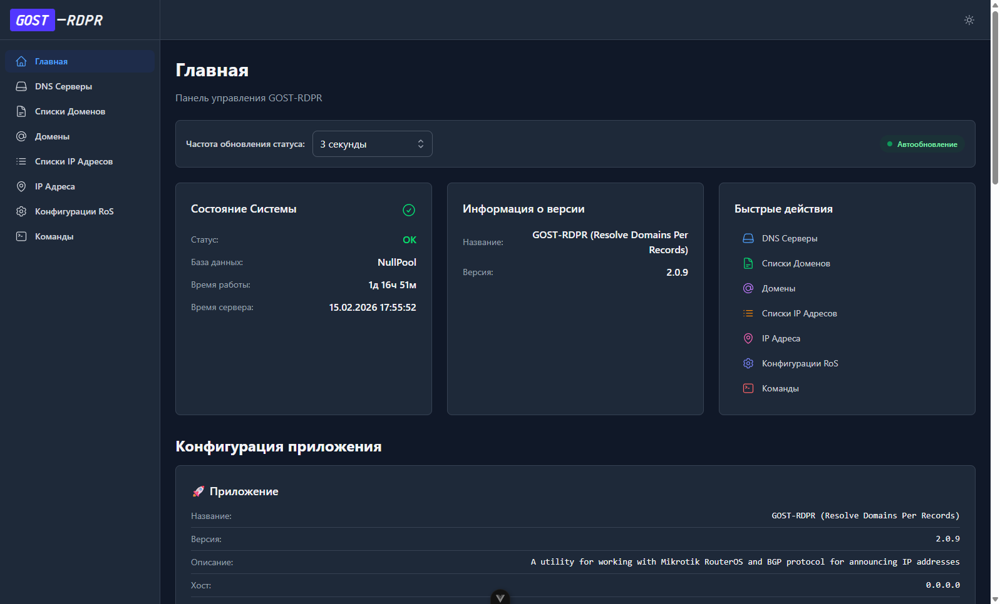
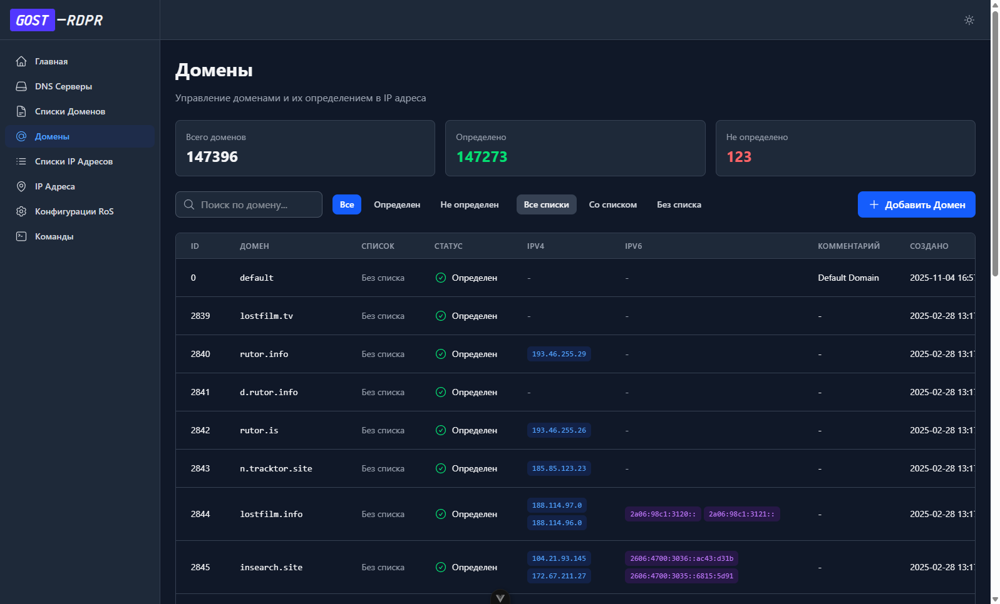

# GOST RDPR (Resolve Domains Per Record)

REPO - <https://github.com/GregoryGost/gost-rdpr>
Docker HUB - <https://hub.docker.com/r/gregorygost/gost-rdpr>

- `latest` tag
- `dev` tag
- `x.x.x` version tag

A utility for working with Mikrotik RouterOS and BGP protocol for announcing IP addresses.

The utility provides parsing of domain names into IP addresses, processing of domain lists and their subsequent parsing,
processing of individual IP addresses and summarized IP groups. Updates firewall address list and routing table.

Docker support OS/ARCH:

- linux/amd64
- linux/arm64

## UI Dashboard

An interface has been developed for the program. Its source code is located in a separate repository.
It can be embedded in a Docker container and is accessible along with the API methods and OpenAPI documentation.

UI REPO - <https://github.com/GregoryGost/gost-rdpr-ui>

<table>
  <tr>
    <td width="50%">
      
      <p align="center"><i>Home page example</i></p>
    </td>
    <td width="50%">
      
      <p align="center"><i>Domains Page example</i></p>
    </td>
  </tr>
</table>

## Application URLs

- `/docs` Swagger/OpenAPI docs
- `/docs/openapi.json` Swagger/OpenAPI json file for export->import to external OpenApi viewer
- `/metrics` - Prometheus metrics

## Environment variables

Available environment variables

| ENV PARAMETER | Type | Default value | Description |
| --------------- | ------ | --------------- | ------------- |
| `ROOT_PATH` | str | `normpath(getcwd())` | Path to the application root folder |
| `ROOT_LOG_LEVEL` | str | `error` | Root level logging |
| `APP_TITLE` | str | `GOST-RDPR (Resolve Domains Per Records)` | Application name |
| `APP_SUMMARY` | str | `A utility for working with Mikrotik RouterOS and BGP protocol for announcing IP addresses` | Description title |
| `APP_DESCRIPTION` | str | `The utility provides parsing of domain names into IP addresses, processing of domain lists and their subsequent parsing, processing of individual IP addresses and summarized IP groups. Updates firewall address list and routing table` | Detailed description of the application |
| `APP_DEBUG` | str | `False` | FastAPI application debug level |
| `APP_VERSION` | str | `2.0.0` | Application version. Get in config from `pyproject.toml` file |
| `APP_HOST` | str | `0.0.0.0` | Listen on IP addr. `0.0.0.0` - Listen on all IP addresses |
| `APP_PORT` | int | `4000` | Listen on TCP/IP specific port |
| `APP_LOG_LEVEL` | str | `error` | Application level logging |
| `QUEUE_MAX_SIZE` | int | `1000` | Positive writer queue capacity and maximum accepted, unstarted explicit domain operations; admission waits when full |
| `QUEUE_GET_TIMEOUT` | float | `0.1` | Maximum waiting time for a queue entry. 0.1s = 100ms |
| `QUEUE_SLEEP_TIMEOUT` | float | `0.01` | The maximum wait time while the queue is empty. At the same time, the infinite loop should allow the scheduler to integrate other tasks into the overall flow. 0.01s = 10ms |
| `RESOLVE_DOMAINS_LOG_EVERY` | int | `10` | Specifies the number of messages that will be logged during domain resolution. Distributes the total volume of domains to resolve among this number |
| `DB_LOG_LEVEL` | str | `error` | SQLAlchemy level logging |
| `DB_TIMEOUT` | float | `30.0` | Maximum time to wait for a database to be freed |
| `DB_BASE_DIR` | str | `db` | A separate folder containing the database. It is also later mounted in a container for downloading to a local PC |
| `DB_FILE_NAME` | str | `rdpr-db.sqlite` | Database file name |
| `DB_TABLE_PREFIX` | str | `rdpr_` | Prefix for database table names |
| `DB_SAVE_BATCH_SIZE` | int | `1000` | Maximum queued commands in one writer transaction; independent of domain scan membership and IP row count |
| `DB_SAVE_BATCH_TIMEOUT` | float | `5.0` | Maximum idle time in seconds between commands received by the writer from its queue; each received command restarts the timer |
| `DB_SHUTDOWN_TIMEOUT` | float | `20.0` | Time in seconds to wait for the database writer during shutdown. Expiry reports unresolved writes; it does not imply a successful drain |
| `DB_TUNE_JOURNAL_MODE` | str | `WAL` | SQLite journal mode: `WAL`, `DELETE`, `TRUNCATE`, `PERSIST` or `MEMORY`. `OFF` is rejected because transactions require rollback support |
| `DB_TUNE_WAL_AUTOCHECKPOINT` | int | `1000` | Initiate a checkpoint approximately every 1000 WAL pages (choose experimentally: if WAL grows too quickly, decrease it; if checkpoints interfere, increase it) |
| `DB_TUNE_SYNCHRONOUS` | str | `NORMAL` | NORMAL - A good balance of performance and reliability for most VDS applications. `FULL`` provides maximum reliability, but is more expensive in terms of I/O. |
| `DB_TUNE_TEMP_STORE` | str | `FILE` | Defines where SQLite stores temporary tables and indexes. `MEMORY` can improve performance but increases memory consumption |
| `DB_TUNE_MMAP_SIZE` | int | `0` | Maximum database file memory mapping in bytes. `0` disables mapping; a negative value restores the SQLite build default. The effective size may be capped by SQLite or the platform |
| `DB_TUNE_CACHE_SIZE` | int | `-2048` | If the value is negative, SQLite treats it as kibibytes; `-2048` means about 2 MiB cache. Positive values are interpreted as number of database pages. Lower values reduce RAM usage; higher values may improve performance at the cost of memory |
| `DB_TUNE_BUSY_TIMEOUT` | int | `2000` | This is the timeout (in milliseconds) during which SQLite will retry acquiring a lock instead of immediately failing with a "database is locked" error. Defaults in SQLite to 0 (no wait). |
| `DB_POOL_SIZE` | int | `5` | The number of connections to keep open inside the read connection pool |
| `DB_POOL_RECYCLE` | int | `1500` | This setting causes the pool to recycle connections after the given number of seconds has passed |
| `DB_POOL_TIMEOUT` | int | `30` | Number of seconds to wait before giving up on getting a connection from the pool |
| `DB_POOL_SIZE_OVERFLOW` | int | `0` | Maximum additional read connections above `DB_POOL_SIZE` |
| `ATTEMPTS_LIMIT` | int | `5` | How many times a file must be checked with a negative result before it (and all its child entities) are deleted from the database |
| `HTTPX_LOG_LEVEL` | str | `error` | HTTPX logging level |
| `REQ_CONNECTION_RETRIES` | int | `3` | Maximum additional attempts through `httpx-retries`, subject to the named client's method, status, exception and retry-sleep policy |
| `REQ_RETRY_BACKOFF_FACTOR` | float | `0.25` | Exponential retry-backoff factor in seconds |
| `REQ_RETRY_BACKOFF_JITTER` | float | `1.0` | Retry-backoff jitter fraction, between zero and one |
| `REQ_RETRY_MAX_BACKOFF_WAIT` | float | `2.0` | Maximum delay for one retry, including `Retry-After` |
| `REQ_RETRY_TOTAL_TIMEOUT` | float | `5.0` | Maximum cumulative retry sleep; excludes network I/O and pool waiting |
| `REQ_TIMEOUT_DEFAULT` | float | `20.0` | Fallback for HTTP write and pool timeouts |
| `REQ_TIMEOUT_CONNECT` | float | `20.0` | Individual timeout for `connect` |
| `REQ_TIMEOUT_READ` | float | `30.0` | Individual timeout for `read` |
| `REQ_TIMEOUT_WRITE` | float or null | `None` | HTTP write timeout; unset values inherit `REQ_TIMEOUT_DEFAULT` |
| `REQ_TIMEOUT_POOL` | float or null | `None` | Pool-slot acquisition timeout; unset values inherit `REQ_TIMEOUT_DEFAULT` |
| `REQ_MAX_CONNECTIONS` | int | `5` | Maximum open connections in each named client's transport pool |
| `REQ_MAX_KEEPALIVE_CONNECTIONS` | int | `30` | Maximum idle connections per named pool, capped by `REQ_MAX_CONNECTIONS` |
| `REQ_SSL_VERIFY` | bool | `True` | When making a request over HTTPS, HTTPX needs to verify the identity of the requested host. To do this, it uses a bundle of SSL certificates (a.k.a. CA bundle) delivered by a trusted certificate authority (CA). You can disable SSL verification completely and allow insecure requests |
| `REQ_DEFAULT_LIMIT` | int | `100` | Maximum number of records returned by a paginated API request |
| `DNS_TIMEOUT` | float | `2.0` | Time in seconds for one ordinary DNS server response |
| `DNS_LIFETIME` | float | `5.0` | Total ordinary DNS resolution lifetime, including its internal attempts |
| `DNS_OPERATION_TIMEOUT` | float | `10.0` | Total budget for one ordinary A or CNAME operation, including semaphore admission |
| `DOH_TIMEOUT_CONNECT` | float | `3.0` | DoH connect timeout |
| `DOH_TIMEOUT_READ` | float | `5.0` | DoH timeout for an individual response read |
| `DOH_TIMEOUT_WRITE` | float | `3.0` | DoH write timeout |
| `DOH_TIMEOUT_POOL` | float | `2.0` | DoH connection-pool acquisition timeout |
| `DOH_CONNECTION_RETRIES` | int | `1` | Maximum additional DoH HTTP attempts within the operation budget |
| `DOH_RETRY_TOTAL_TIMEOUT` | float | `1.0` | Maximum cumulative DoH retry sleep |
| `DOH_OPERATION_TIMEOUT` | float | `10.0` | Total budget for one DoH A or CNAME operation, including semaphore, pool, retry and response-body waits |
| `DOMAINS_FILTERED_MIN_LEN` | int | `3` | The minimum domain length required to save it to the database. This is necessary to filter out empty domains that, for some reason, are generated in MikroTik scripts |
| `DOMAINS_UPDATE_INTERVAL` | int | `172800` | Seconds after a complete resolution checkpoint before automatic stale eligibility; explicit saved-ID requests bypass this interval |
| `DOMAINS_RESOLVE_WORKER_LIMIT` | int | `4` | Positive shared maximum of saving domain operations in DNS, preparation or writer admission across new, stale and explicit requests |
| `DOMAINS_RESOLVE_SEMAPHORE_LIMIT` | int | `20` | Positive shared limit of concurrent classic DNS and DoH A/CNAME operations, including single-domain checks |
| `DOMAINS_RESOLVE_NEW_BATCH_SIZE` | int | `500` | Legacy setting retained for configuration compatibility; automatic NEW scans now select their complete finite membership |
| `DOMAINS_RESOLVE_STALE_BATCH_SIZE` | int | `2000` | Legacy setting retained for configuration compatibility; automatic STALE scans now select their complete finite membership |
| `DOMAINS_BLACK_LIST` | str | `None` | Domains that should not be included in the database. Comma-separated list |
| `LISTS_UPDATE_INTERVAL_SEC` | int | `604800` | The period after which the file must be uploaded and verified again. Specified in seconds. 604800s = 7days |
| `IP_NOT_ALLOWED` | str | `0.0.0.0/8, 10.0.0.0/8, 100.64.0.0/10, 127.0.0.0/8, 169.254.0.0/16, 172.16.0.0/12, 192.0.2.0/24, 192.88.99.0/24, 192.168.0.0/16, 198.18.0.0/15, 198.51.100.0/24, 203.0.113.0/24, 224.0.0.0/4, 240.0.0.0/4, ::/128, ::1/128, fc00::/7, fe80::/10, ff00::/8, 2001:db8::/32` | Comma-separated CIDR networks that must not be saved in the database. |
| `ROS_REST_API_READ_TIMEOUT` | float | `59.0` | ROS REST API server timeout = 60s |
| `ROS_REST_API_DEFAULT_TIMEOUT` | float | `59.0` | Default timeout for RouterOS REST API requests |
| `ROS_REST_API_WRITE_TIMEOUT` | float or null | `None` | RouterOS write timeout; unset values inherit `ROS_REST_API_DEFAULT_TIMEOUT` |
| `ROS_REST_API_POOL_TIMEOUT` | float or null | `None` | RouterOS pool-slot timeout; unset values inherit `ROS_REST_API_DEFAULT_TIMEOUT` |
| `RIPE_STAT_BASE_URL` | str | `https://stat.ripe.net` | RIPEstat API base URL for IPv4 prefix lookups |
| `RIPE_STAT_TIMEOUT_CONNECT` | float | `3.0` | RIPEstat connect timeout |
| `RIPE_STAT_TIMEOUT_READ` | float | `5.0` | RIPEstat timeout for an individual response read |
| `RIPE_STAT_TIMEOUT_WRITE` | float | `3.0` | RIPEstat write timeout |
| `RIPE_STAT_TIMEOUT_POOL` | float | `2.0` | RIPEstat connection-pool acquisition timeout |
| `RIPE_STAT_CONNECTION_RETRIES` | int | `1` | Maximum additional RIPEstat HTTP attempts within the lookup budget |
| `RIPE_STAT_RETRY_TOTAL_TIMEOUT` | float | `1.0` | Maximum cumulative RIPEstat retry sleep |
| `RIPE_STAT_OPERATION_TIMEOUT` | float | `10.0` | Total budget for one prefix lookup, including cache, cache-lock, retry and response-body waits; resolver lookups also include semaphore admission |
| `RIPE_STAT_REQUESTS_SEMAPHORE_LIMIT` | int | `5` | Maximum number of concurrent RIPEstat prefix lookups during domain resolving |
| `RIPE_STAT_CACHE_SIZE` | int | `10000` | Maximum number of RIPEstat prefix records in the in-memory cache |
| `RIPE_STAT_PREFIX_CACHE_TTL_SEC` | int | `28800` | TTL in seconds for a RIPEstat result with a prefix |
| `RIPE_STAT_EMPTY_PREFIX_CACHE_TTL_SEC` | int | `3600` | TTL in seconds for a RIPEstat result without a prefix |
| `RIPE_STAT_CACHE_LOCK_TTL_SEC` | int | `120` | Maximum lifetime in seconds of a per-IP RIPEstat cache lock |

## Outbound HTTP connections

`HttpClient` owns one reusable client and transport pool per name. Connection limits are passed to the base
`AsyncHTTPTransport`; they do not limit requests per second or all clients together. With the defaults, each pool
allows five open connections and at most five idle connections, despite the configured idle limit of thirty.
HTTPX retains its five-second idle connection expiry.

`RetryTransport` is the only automatic retry owner; native transport retries are disabled. Ordinary clients retry
`GET` and `HEAD`. The RouterOS profile retries `GET`, `POST`, `PATCH` and `DELETE`; `PUT` is always sent once,
including on connection failure. Existing RouterOS `POST` calls only read `/print` output, while `PUT` creates
tables, firewall entries and routes. A missing object (`404`) during deletion already satisfies the desired state.

Retryable HTTP statuses are `429`, `502`, `503` and `504`. The selected transport exceptions are `ConnectError`,
`ConnectTimeout`, `ReadError`, `ReadTimeout`, `WriteError`, `WriteTimeout` and `RemoteProtocolError`. Pool exhaustion,
cancellation and response-body failures after the transport returns are not replayed. The retry count limits
additional attempts, and exponential backoff, jitter and `Retry-After` are bounded by the delay settings above.
`REQ_RETRY_TOTAL_TIMEOUT` caps cumulative sleep only; it is not an end-to-end request deadline.

All clients have explicit connect, read, write and pool timeouts. General defaults are `20/30/20/20` seconds;
DoH and RIPEstat each use `3/5/3/2`, and RouterOS uses `20/59/59/59`. General and RouterOS write and pool overrides
inherit their integration's default when unset. Read and write
timeouts bound individual I/O waits, not an entire streamed response. Reusing a client name with a conflicting
effective configuration raises an error. Application shutdown closes the retry and base transports through the
existing metrics wrapper. Environment certificate configuration remains supported; environment proxies are not used.

DoH and RIPEstat use their own retry-count and cumulative-sleep settings instead of `REQ_CONNECTION_RETRIES` and
`REQ_RETRY_TOTAL_TIMEOUT`. The common retryable methods, statuses, exceptions, backoff and jitter still apply.
Use `DOH_TIMEOUT_*` and `RIPE_STAT_TIMEOUT_*` to override their phase timeouts; general `REQ_TIMEOUT_*` settings
continue to configure the other HTTP clients.
Their operation deadlines bound the complete asynchronous lookup, including response-body consumption; a slow stream
cannot extend a lookup indefinitely by delivering small chunks. Duration settings must be positive and finite;
retry counts may be zero to disable retries.

Ordinary DNS explicitly uses `DNS_TIMEOUT` and `DNS_LIFETIME`. Each ordinary DNS or DoH A/CNAME query has its own
operation budget, including admission to the shared DNS semaphore. These budgets apply to bulk, stored-domain and
one-shot resolution. They are per-query budgets, not a deadline for an entire domain or job. All configured server
results are combined; a timeout is failed evidence and cannot confirm the disappearance of stored addresses.

Independent eligible IPv4 prefix lookups run concurrently through a bounded set of workers and the existing shared
RIPEstat semaphore. Each lookup includes its semaphore wait in its operation budget. External cancellation propagates
after workers are stopped and awaited. A failed or expired RIPEstat lookup retains the matching stored CIDR when one
exists, otherwise the host address; failures are not cached as successful empty prefixes.

## Database connections

Both database engines configure each new physical SQLite connection before application SQL runs.
Connection settings are validated and checked against the effective PRAGMA values. A configuration failure prevents
the connection from being used. Memory mapping may be limited by the SQLite build or platform.
Pooled read connections retain their settings between reads; replacement connections and every new writer connection
receive the same setup. Ordinary reads do not repeat the configuration commands.

The configured journal mode is requested and checked before a transaction starts. `WAL` remains the default.
`DELETE`, `TRUNCATE`, `PERSIST` and `MEMORY` are also supported. `OFF` is rejected instead of silently substituting
another mode. `MEMORY` supports ordinary rollback but does not provide a journal that survives a process crash.

Schema initialization temporarily disables foreign-key enforcement on its dedicated write connection before
`BEGIN IMMEDIATE`, then validates managed foreign keys before committing. That connection is physically closed;
runtime connections start with foreign-key enforcement enabled.

## Database writes and shutdown

Runtime database changes pass through one bounded in-memory writer queue. Enqueue success means that a command was
accepted into memory; it does not confirm commit or immediate visibility to reads. A full batch is flushed immediately.
A partial batch is flushed when the writer receives no further command for `DB_SAVE_BATCH_TIMEOUT`, or during graceful
shutdown without waiting for that timeout. Each successful queue receive restarts the idle timer. Continuous arrivals
can extend collection until `DB_SAVE_BATCH_SIZE` is reached. The timeout does not limit the oldest command's age
or its wait for commit.

DNS results are prepared before the write transaction and reconciled in ordered groups. Repeated results for one
domain keep their admission order. Global IP records and independent support relationships use explicit multi-row
inserts, with IDs matched by the exact address string. Complete results withdraw obsolete IPv4 supports by their
support IDs; partial results only add evidence. Global orphan cleanup and representative repair still run once after
all command categories, preserving shared IP identity during transfers between domains.

SQL portions are independent of `DB_SAVE_BATCH_SIZE`. They use the physical connection's native parameter limit,
capped at 900 parameters, including client defaults and query predicates. Large results remain in one transaction.
The native limit bridge is verified for aiosqlite 0.22.1 and fails closed for unsupported versions or insufficient
limits; revalidate that driver boundary before upgrades. This change does not require a schema migration.

Only SQLite busy/locked failures before commit are retried, after the failed transaction has been rolled back and
released. The same batch stays ahead of later commands, with at most three attempts and delays of 0.1 and 0.2 seconds.
Commit errors and cancellation are not automatically replayed because their persistence outcome can be unknown.
On a permanent failure, the writer rejects further commands and reports pending or unknown outcomes instead of
discarding the failed batch. The nonblocking IP-record deletion API retains its boolean rejection result.

New writer connections receive the configured SQLite settings, including foreign-key constraints and deletion
cascades, before the batch transaction. A resolution command referencing a deleted domain fails its batch rather
than creating orphan IP records; the normal terminal-failure policy then applies.

Graceful shutdown first closes saving-coordinator admission and cleans up work not yet admitted to the writer.
It then closes writer admission, finishes accepted commands and the final partial batch, and releases the database
engines. Mandatory outcome bookkeeping remains alive through retained native cleanup before HTTP clients close.
A deadline or forced cancellation reports unresolved work and retains ownership of any ongoing cleanup.
`DB_SHUTDOWN_TIMEOUT` covers the database wait, not the total application or container shutdown time.
The queue is process-local and does not recover pending commands after a crash or forced process termination.

## Shared IP ownership

Each exact IP address or CIDR has one global record, with independent domain and IP-list support relationships.
Domain output includes all addresses supported by that domain; global IP output and RouterOS contain one record
per exact address. Their scalar domain/list fields identify a representative support. The existing representative
stays selected while that support exists; removing it selects a remaining support deterministically. Explicit IP
comments and gateway flags remain properties of the global record.

A complete trustworthy IPv4 result replaces only that domain's IPv4 support and advances its refresh checkpoint
in the same writer transaction. Partial results add reliable positive support; failures preserve existing support
and checkpoints. Support from another domain keeps the address present. DNS and IP-list support remain independent,
including when they refer to the same domain. IP-list refresh withdraws only the affected list support.

An IP explicitly assigned to a positive domain ID participates in that domain's DNS reconciliation, including when
it was added manually. Domain ID `0` represents standalone ownership. Explicit `/ips` deletion and blocked-address
cleanup remove the global record and all its support; a later permitted positive observation can create it again.

Migration `migration_202618042123.py` upgrades existing ownership without rewriting previous migration sources or
history. It preserves existing IP IDs and metadata and records the previously known owner/list relationship.
Previously discarded secondary owners can only be learned through subsequent DNS observations. Startup validates
the upgraded schema and support relationships before starting the writer. Running an older application against
the upgraded database is unsupported; reverting requires the matching previous database and application version.

## Concurrent domain processing

One application-owned coordinator shares `DOMAINS_RESOLVE_WORKER_LIMIT` workers across new-domain, stale-domain and
explicit saved-ID resolution. A worker handles DNS, address preparation and writer admission, then becomes available
without waiting for commit. `DOMAINS_RESOLVE_SEMAPHORE_LIMIT` independently limits DNS/DoH A/CNAME operations across
all entrypoints, including checks without saving. RIPEstat retains its separate shared limit.

Accepting NEW demand pauses subsequent STALE dispatch, including during selection. Already started STALE operations
finish normally; free workers take ready NEW work. Explicit saved-ID requests have the same priority, even for a
recently resolved domain. Each accepted explicit request receives a distinct fresh attempt. Attempts for the same ID
are serial; another ready NEW domain can run while that ID waits for its predecessor's known writer outcome.
Checks without saving use an independent request path. Neither switching priority nor finishing a pass waits for
all STALE commits. Continuous NEW demand can postpone STALE work indefinitely.

Each automatic pass reads its entire finite eligible membership in stable order as lightweight detached records.
Results, IP snapshots and endpoint tasks are created when processing starts. Snapshot and ownership metadata use
O(N) memory; they are not a constant-memory stream. The legacy NEW/STALE batch-size settings no longer cap a pass.
`DB_SAVE_BATCH_SIZE` controls writer commands per transaction, `DOMAINS_UPDATE_INTERVAL` controls stale freshness,
and the worker and semaphore limits control different levels of concurrency.

A repeated NEW trigger after membership capture records one pending successor; repeated mass triggers coalesce.
The successor takes its snapshot after the current NEW list finishes processing/admission, without waiting for all
commits. At most one current and one pending NEW pass are retained. Domains committed after capture need a later
trigger. Repeated active STALE requests retain the already-active
response. Active or pending-write domains and real attempts crossing selection/adoption are excluded from duplicate
automatic work. A cancelled reservation alone is not coverage. Unknown write outcomes retain domain ownership;
there is no TTL-based release or automatic replay.

Cancellation awaits nested preadmission cleanup and preserves work needed by other interests. HTTP acceptance
transfers work to the coordinator, so client disconnection does not remove an accepted request. Writer-admitted
commands remain owned by the database. Terminal writer failure stops saving dispatch and fails pending obligations,
while retaining unknown-outcome ownership. Processing completion does not establish commit or crash durability.

## DNS configuration during resolution

Each nonempty new-domain or stale-domain job reads its DNS configuration once before starting queue processing.
All domains and their A/CNAME queries use that job's immutable snapshot, including the DNS row IDs used by metrics.
The database session is released before network operations begin.

DNS changes committed after the snapshot is read apply to the next job. Accepting an HTTP request or enqueueing a
configuration change does not establish commit visibility; rolled-back changes are not published.
Single-domain operations read committed configuration when they start. An explicit selection of DNS server IDs
continues to use those selected servers. When no custom servers remain, selection falls back to the default row `0`.

A DNS configuration read failure aborts a job before domains are enqueued, preserving previously stored IP records.
No previous job's snapshot is reused after a failed read.

Each configured endpoint is queried for A records first. Reachable CNAME chains in that response are returned by
single-domain checks and queued for storage by resolving jobs, with the source domain's list ID. A successful address
response or confirmed absence needs no separate CNAME query. A failed A query without usable alias evidence permits
one best-effort CNAME query to the same endpoint. A valid CNAME chain without addresses or confirmed absence remains
failed IPv4 evidence: storing its aliases never permits deleting previous IP records or advancing the refresh time.
Cancellation propagates without starting an alias query.

Ordinary DNS resolvers belong to one job or single-domain operation. Each endpoint reuses its own resolver with fixed
nameserver, timeout and lifetime settings, including any CNAME query after A failure. A later job creates new resolvers
from its own configuration snapshot. Endpoints remain independent so their addresses can be unioned before storage.

DNS response caching remains disabled. Reusing a resolver does not enable its response cache. The local measurement
providers return TTLs of 60 seconds, while the default successful-domain update interval is 172800 seconds. A normal
pass queries each selected name once per endpoint; the synthetic warm pass deliberately resets domain state and is
not evidence of production cache reuse. Repeated manual checks or shorter update intervals may benefit from caching,
but production TTLs and repeat frequencies have not been measured. Before enabling a cache, measure those values and
define endpoint isolation, bounded capacity, positive and negative expiry, and validation before cache admission.
Never reuse another server's answer or cache a failed DNS query as successful empty evidence.

## Resolution measurements

`/metrics` exposes separate measurements for processing, queue admission and confirmed database commands.
All durations use monotonic clocks and seconds. Nested phase durations overlap and must not be added as wall time.

| Metric family | Meaning |
| ------------- | ------- |
| `httpx_requests_total` | Started transport exchanges, including failures without a response |
| `httpx_responses_total` | Exchanges that received response headers, grouped by HTTP status |
| `httpx_requests_duration_seconds` | Transport entry to the first stream terminal; includes consumer pauses |
| `httpx_request_headers_duration_seconds` | Transport entry to response headers or a transport error |
| `httpx_exchanges_started_total`, `httpx_exchanges_terminal_total`, `httpx_exchanges_in_flight` | Exchange lifecycle conservation by integration |
| `httpx_exchange_duration_seconds` | Full exchange lifecycle by integration, terminal phase and outcome |
| `httpx_stream_cleanup_errors_total` | Cleanup failures after an already observed stream terminal |
| `resolution_dns_duration_seconds`, `resolution_dns_semaphore_wait_seconds` | DNS query/validation and semaphore wait by server ID, transport, record type and outcome |
| `resolution_ripe_duration_seconds` | RIPEstat cache, lock, network and logical lookup phases |
| `resolution_queue_duration_seconds` | Queue admission, residence and pending-batch waits |
| `resolution_writer_duration_seconds` | Write attempts, preparation, IP reconciliation, final support cleanup, transactions, commit and session cleanup |
| `resolution_writer_batch_size` | Commands, resolution intents and input address entries per prepared attempt; retries count again |
| `resolution_writer_sql_dispatches_total` | Attempted write-engine DBAPI calls by actual execute, executemany or execute_no_params method |
| `resolution_writer_sql_parameter_sets_total` | Submitted parameter sets by actual DBAPI method; a multi-VALUES execute counts one set |
| `resolution_run_events_total`, `resolution_run_elapsed_seconds` | Cumulative run events and processing duration |
| `resolution_run_snapshot` | Fields of the latest started run for each `new`, `stale` or `stored` mode |

HTTP measurements observe each transport exchange separately; redirects and authentication exchanges can create
several exchanges for one logical request. Existing connection retries remain inside an exchange. A completed stream
does not imply a successful HTTP status, DNS result or JSON payload. Unconsumed, unclosed streams remain in flight.
Metrics never consume response bodies. Legacy HTTP exception labels retain their names, with `host` and `path`
set to `redacted` and errors mapped to fixed categories.

DNS `server_id` is the existing configuration row ID, including the fallback row `0`; use the DNS API to identify it.
It is not an immutable endpoint identity. Historical ID series last for the process lifetime, and reused SQLite IDs
aggregate under that key. Configuration churn can increase historical series. Queried domains, addresses, URLs,
credentials and run IDs are not metric labels. CNAME `no_alias` does not prove absence of IPv4 addresses.

Run processing outcomes are `success`, `partial`, `failure` and actual processing cancellation. Confirmed absence
of addresses is successful evidence. Partial evidence remains partial even when no new addresses require a write.
Admission failure is separate from an already established processing result. Automatic coverage by another attempt
does not create another physical attempt or commit; explicit operations retain the `stored` metric origin even with
NEW priority. Best-effort CNAME discovery and RIPEstat
fallback have their own observations.

Persistence fields distinguish `admitted`, `pending`, `confirmed`, `known_not_committed` and `unknown`, plus rejected
admission and results needing no write. `confirmed` means a source-domain result command had a known commit, including
partial results; it does not count inserted IP rows, CNAME commands or records surviving a later deletion. Retry
attempts do not increase confirmed counts. A known commit remains confirmed after cleanup failure. An ambiguous
commit remains unknown; an interrupted in-flight operation can acquire a known outcome later.

The processing summary uses the existing job completion boundary and does not wait for the database writer.
Later receipts update persistence statistics. `processing_rate` counts attempted domains per processing second;
compare success/partial/failure counts alongside that rate. `saved_rate` counts confirmed result commands per second
through processing and known persistence completion. Final rates have explicit `*_rate_valid` fields; unknown,
interrupted or zero-duration measurements are invalid and use `NaN`, rather than a fabricated zero. A completed run
with no required writes can have a valid saved rate of zero. Late receipts from an older run cannot replace a newer
run's snapshot for the same mode. All observations are process-local and do not provide crash durability.

Writer SQL counters observe actual dialect dispatch, including failed attempts and startup statements. They do not
count successful SQLite virtual-machine statements, trigger work, native commit/rollback or raw connection PRAGMAs.
An `executemany` call submits several parameter sets; an explicit multi-VALUES `execute` submits one. Compare metric
deltas over the same workload boundary. Mixed workload measurements include auxiliary API writes. The callback,
counter updates and phase observations remain inside the measured work; observations do not own commit receipts.

### Local load campaigns and API responsiveness

Load testing extends the existing pytest suite and local DNS, DoH and RIPEstat protocol providers. All measurements
run in the current workspace; a separate machine or infrastructure is not required. The application still runs its
real entrypoint, composition, startup migrations and shutdown against a disposable SQLite database. Production
databases, local secret files and uncontrolled external services are outside the test boundary.

API responsiveness is a mandatory selection criterion for resolution defaults. A full STALE pass through known
persistence must also finish within 30 minutes, with 15 minutes as the preferred target. For 187558 input domains,
these correspond to approximately 104.2 and 208.4 domains/s. Pilot extrapolations screen candidates; only actual
full-size repeated passes establish that the deadline is met. Compare higher bounded concurrency before full-size
finalist validation, and preserve data correctness and API responsiveness throughout.

Compare an idle baseline with
continuous public domain/statistics requests and controlled write/job admission while background resolution is
active. Freeze finite timeout and latency-regression limits before comparing candidates. Record measured API
quantiles separately from estimates interpolated from Prometheus histogram buckets. A health response, early job
acceptance or processing completion alone does not prove responsiveness or confirmed persistence.

The initial local sizing on 2026-11-04 counted 156298 domain rows with `id > 0`, excluding the service row, in
`db/rdpr-db.sqlite`. The immutable read used an empty WAL and verified the main-file SHA256 before and after:
`f4d879fdc3c488ca4955f5c4de71d46530e75a57ecf00f5b7c09ba8031132555`.
The corresponding half/full/20%-headroom ladder is 78149, 156298 and 187558 input domains. Learned aliases and probe
records are accounted for separately. Preserve the count, observation date, seed, provider schedule, source hashes,
dependency versions, actual settings and current hardware in the machine-readable results.

Prepare disposable seed data only after real migration startup and with the application stopped. Application
outcome checks use public HTTP/metrics and exact API reads after restart. Controlled repeated STALE experiments may
explicitly override the refresh interval to make the workload eligible; report that as a workload override, preserve
it identically across candidates, and keep the initial NEW baseline on genuine production defaults. Such an override
does not justify changing the production freshness policy.

Explicitly selected smoke profiles validate the machinery at a small size and do not establish full-load acceptance
or justify new defaults. Full comparisons require the configured ladder, separate warmup, at least three measured
repetitions per compared configuration, degraded-provider checks, restart validation and the independent regression
checks. Process resource limits in a campaign protect the local test run; they are not deployment hardware promises.

Run a small, explicitly non-acceptance smoke campaign on Windows:

```powershell
$measurementTemp = Join-Path ([System.IO.Path]::GetTempPath()) ('rdpr-load-smoke-' + [guid]::NewGuid().ToString('N'))
$previousLoadConfig = $env:GOST_LOAD_CONFIG
try {
  $env:GOST_LOAD_CONFIG = @{
    profile = 'smoke'
    n = 32
    factors = @(1)
    repetitions = 1
    warmup_size = 8
    baseline_samples = 3
    candidates = @(@{ name = 'defaults'; environment = @{} })
  } | ConvertTo-Json -Depth 5 -Compress
  .\.venv\Scripts\python.exe -B -m pytest -n 0 -m e2e_load -k resolution_load `
    -p no:cacheprovider --basetemp $measurementTemp
  if ($LASTEXITCODE -ne 0) { throw 'Load smoke checks failed' }
} finally {
  $env:GOST_LOAD_CONFIG = $previousLoadConfig
}
```

The normal `-m e2e_load` selection uses the full profile unless `GOST_LOAD_CONFIG` explicitly selects smoke.
For the full observed scale, use a fresh temporary directory and set `GOST_LOAD_CONFIG` to
`{"profile":"full","n":156298,"headroom":0.2,"repetitions":3}` before running the same command without the
`-k` filter. Restore the previous environment value afterward. Full profile validation requires the half/full/
headroom ladder and at least three measured repetitions. Candidate environments are restricted to tuning settings;
database paths, provider targets, durability and freshness settings cannot be changed through that candidate list.

For a bounded diagnostic replay, `stages` selects from `baseline`, `warmup`, `healthy` and `degraded`;
`candidate_names` and `repetition_numbers` select subsets of the configured matrix. The default runs every stage,
candidate and repetition. For example, a single true-default pass at the observed headroom population uses
`{"profile":"smoke","n":156298,"factors":[1.2],"repetitions":1,"stages":["baseline"]}`.
The smoke label describes incomplete acceptance evidence, even when its individual pass uses the full population.
Custom-small full-profile branch checks and filtered replays are likewise labeled non-acceptance in the artifact.
Retain identical source hashes, schedules and frozen API limits when comparing or combining diagnostic results.

The finite whole-pass safety timeout is configurable and defaults to 14400 seconds for diagnostic/baseline runs.
It does not override the 1800-second acceptance limit for full-size STALE passes; a slower candidate is ineligible.
API request/maximum guards remain 5 seconds, with a frozen p99 limit of
`min(5, max(1, idle_p99 * latency_factor + latency_slack))` seconds per route. Record raw measured delays as well as
these conservative local guardrails. Longer source passes do not permit longer API requests.

Measure each HTTP exchange independently, including domain reads, lists, statistics and write/job admission.
Canary creation, resolution and deletion remain functional persistence checks under the finite pass budget;
their end-to-end waiting time is separate from HTTP latency and has no independent 60-second acceptance limit.
Retain completed source-pass measurements and HTTP observations when a later validation or probe drain fails,
while keeping the failed verdict explicit. Cancelled requests do not count as completed HTTP responses.

`resolution-load-campaign.json` contains the incremental cases, frozen API guardrails, exact public-result checks,
restart verification, calibrated provider capacity, generator overhead, actual child resource measurements and
repetition summaries. `resolution-load-resilience.json` records bounded priority/failure/recovery/soak/shutdown
scenarios. Retain the artifact directory when inspecting a failure; partial and failed cases must not be treated as
successful comparisons. Ordinary unit/integration/E2E regressions and configured quality/coverage checks run separately.

### IP persistence revision comparison

The separate revision comparison uses 10000 source domains and at least three measured passes after excluded warmup.
It keeps one cold process-local cache per pass, identical settings and provider schedules, and shared frozen API guards.
It verifies every source domain through the API and after restart. This bounded comparison does not establish the
full-population 15-30 minute target and does not select production defaults.

Preserve the instrumented original source before changing the persistence algorithm. Each immutable snapshot includes
the explicit application source whitelist, the shared test harness and `source-manifest.json`. The child entrypoint,
imports, configuration and migrations must all use that snapshot. Before/after compatibility checks require every
common input, including instrumentation and the harness, to match; only `database/db.py` may differ.

The recorded local snapshots are under `.pytest_cache/ip_batch_20261106/before-source-v3` and `after-source-v3`.
With those snapshots and the matching repository harness, run a new pair with fresh output and guard paths:

```powershell
$comparisonRoot = (Resolve-Path '.pytest_cache/ip_batch_20261106').Path
$comparisonBounds = Join-Path $comparisonRoot ('bounds-' + [guid]::NewGuid().ToString('N') + '.json')
$previousComparisonConfig = $env:GOST_BATCH_COMPARE_CONFIG
try {
  foreach ($comparisonVariant in @('before', 'after')) {
    $comparisonTemp = Join-Path $comparisonRoot ($comparisonVariant + '-' + [guid]::NewGuid().ToString('N'))
    $env:GOST_BATCH_COMPARE_CONFIG = @{
      variant = $comparisonVariant
      source_root = (Join-Path $comparisonRoot ($comparisonVariant + '-source-v3'))
      bounds_path = $comparisonBounds
      n = 10000
      repetitions = 3
      warmup_size = 128
      pass_timeout = 1800
      verify_timeout = 600
    } | ConvertTo-Json -Compress
    .\.venv\Scripts\python.exe -B -m pytest -n 0 -m e2e_load `
      tests/integration/test_domain_resolution_persistence.py::test_ip_persistence_revision_comparison `
      -p no:cacheprovider --basetemp $comparisonTemp
    if ($LASTEXITCODE -ne 0) { throw 'IP persistence comparison failed' }
  }
} finally {
  $env:GOST_BATCH_COMPARE_CONFIG = $previousComparisonConfig
}
```

The new comparison is skipped by the ordinary load selection unless `GOST_BATCH_COMPARE_CONFIG` is supplied.
An explicitly supplied invalid configuration fails. Smoke mode is limited to 64 domains and one measured pass;
its artifacts cannot satisfy comparison acceptance. Retain raw JSON, logs and failed attempts, and use fresh paths
instead of overwriting a recorded source, guard file or result directory.

The completed local comparison on 2026-11-06 used Python 3.15.2, SQLite 3.53.4, SQLAlchemy 2.1.6,
aiosqlite 0.22.1, Windows 11, an i5-13600KF and 64 GiB RAM. Both revisions used batch size 256,
flush timeout 0.25s, four resolution workers and the same deterministic providers and seeded ownership/checkpoints.
Every measured pass verified all 10000 source results through the API and after restart. The three source timings
were 152.672/146.545/144.659s before and 82.975/82.246/82.442s after: median speedup **1.778x**,
or **43.74% less time**.

| Measurement | Before | Batched |
| --- | ---: | ---: |
| Median confirmed source-pass time, s | 146.545 | 82.442 |
| Timing spread, max minus min, s | 8.013 | 0.729 |
| Median attempted writer DBAPI dispatches | 110249 | 847 |
| Median aggregate preparation, s | 0.0111 | 0.0723 |
| Median aggregate IP/support reconciliation, s | 141.580 | 4.827 |
| Median aggregate global finish, s | 0.450 | 0.932 |
| Median aggregate transaction, s | 142.460 | 6.690 |
| Median aggregate commit, s | 0.141 | 0.364 |
| Median application CPU time, s | 162.938 | 82.594 |
| Median CPU, percent of one core | 111.19 | 100.18 |
| Median per-pass peak RSS, MiB | 141.16 | 138.47 |
| Maximum sampled HTTP latency, ms | 141.43 | 170.43 |
| Maximum per-pass route p99, ms | 128.17 | 158.69 |

Phase totals are nested and include auxiliary API writes; do not add them or equate them with source wall time.
Actual prepared attempts numbered 44-45 before and 45-46 after, averaging 240-250 commands per attempt.
The global finish algorithm was preserved and its cost was measured separately. Its aggregate time and commit time
increased in this workload; reconciliation and end-to-end elapsed time improved. Nine routes were sampled under load:
domain detail/list, search, statistics, job status, IP-list detail/list, additions and deletions. `stored_resolve` was
an additional idle-baseline route only. Every measured route met its frozen 5s maximum and 1s p99 limits, with no HTTP
failures. Per-pass CPU remained below 200% of one core and peak RSS below 2048 MiB. These bounds describe this local
comparison; they do not establish full-population acceptance or unchanged individual API percentiles.

Raw passes, exact hashes, settings, resources, route samples and guards are retained in
`.pytest_cache/ip_batch_20261106/{before,after}-run-03/test_ip_persistence_revision_c0/ip-persistence-comparison.json`.
The combined `comparison-summary.json` in the same comparison root links both raw files and their SHA256 values.
An earlier pair failed before the first measured batched pass because startup assigned domain 0 a different current
checkpoint. Those artifacts were retained; the offline fixture now assigns that checkpoint deterministically, keeps
the complete selected-data hash guard, and the final pair was repeated in full. Generated metadata timestamps are
outside that hash. An isolated observer benchmark measured a median 1.659 microseconds per callback across three
100000-call repetitions after warmup; SQLAlchemy event-framework overhead is outside that isolated measurement and
all observation overhead remains inside the application timings.

Functional validation passed 784 serial non-load tests before the final fixture-only correction; nine focused fixture
checks passed afterwards. Independent production and fixture reviews found no actionable issues. P1-14 was accepted
on 2026-11-06 after the user explicitly confirmed that repository-wide Ruff/format/Pyright failures and the coverage
threshold do not block this task. Recorded results remain: coverage 71.23% against 85%, Ruff 696 errors, 50 files
requiring formatting, and Pyright 60 errors/0 warnings. The changed Python paths pass Ruff and format checks.
Tool settings and historical validation verdicts were preserved; this acceptance exception applies only to P1-14.

### Bounded parameter screening outcome

The 2026-11-04 parameter search stopped after four experimental series, including the initial exploratory pilot.
Production resolver/writer code and defaults were not changed. These are screening results, not full-load acceptance;
the 187558-domain deadline and repeated full-size comparisons remain unverified.

| Series | Workload and candidates | Observed outcome |
| --- | --- | --- |
| 1 | 1024 domains, 4/8 workers, earlier harness | Exploratory only; later oracle/measurement corrections supersede it. |
| 2 | 1024 domains, defaults/16/wide 64 workers | Warm confirmed rates 60.01/84.04 per second; wide 64 failed list p99 at 1.2403s against 1s. |
| 3 | 1024 domains, smooth 32/bounded 64 workers | Cold 75.49/75.41 and warm 87.77/85.49 confirmed per second; API guards passed. |
| 4 | 8192 domains, the smooth 32-worker candidate | Canary lifecycle exceeded 60s while awaiting confirmed resolution; shutdown failed its 20s writer-drain budget. |

The smooth candidate uses workers32, DNS concurrency64, RIPE concurrency16, HTTP/keepalive32, queue512, batch128
and flush0.1s. In series 3 its measured list p99 was 0.416s cold and 0.413s warm; application CPU averaged about
106% of one core, with peak RSS below 134MiB. Bounded 64-worker processing completed in 6.63s warm but persistence
took 11.93s. Writer transaction/residence histogram estimates are seconds, while commit estimates are milliseconds;
these observations identify persistence work for investigation, not the cost of an individual SQL statement.

The final series stopped before a complete source pass. Its last progress sample at 100.77s had 2060 attempted,
1447 confirmed and 581 pending source outcomes. No full-pass rate, successful drain or API-request timeout can be
inferred from that sample: the triggering timeout was the canary's end-to-end lifecycle. Warm/degraded checks for
8192 domains were not reached. Separate follow-up work must address persistence cost and public-operation progress,
then repeat the unchanged guards before selecting defaults. Do not continue tuning beyond the four-series cap or
weaken the workload, provider failures, freshness, persistence guarantees or API bounds to obtain a pass.

Current corrected artifacts are retained locally under `.pytest_cache/`, in these generated run directories:

- `concurrency-search-66cbed41fbc947e7b8f74d70f9fedea9` (series 2).
- `concurrency-search-3fd1d8dcca1c4c9d9f19c175a9fb6cdc` (series 3).
- `final-parameter-check-10ca1a2e35d14d98a1da243727710fcb` (series 4).

Each contains `test_resolution_load_campaign_0/resolution-load-campaign.json` with the exact `configuration` for
replay, source hashes, local dependency versions and machine metadata. Replay with a fresh disposable `--basetemp`;
retain the original failed output. The model deliberately includes several IPv4 results and frequent eligible RIPE
lookups. Stored-IP aggregates alone do not establish its equivalence to real DNS fanout or provider/cache behavior.

### Historical small local baseline

The explicitly selected `e2e_load` scenarios use the real application entrypoint and lifespan, disposable SQLite,
and local DNS, DoH and RIPEstat protocol providers. They record fixed workloads and safe settings, cold/warm cache
conditions, fast/slow/unavailable providers, processing and persistence measurements, actual database effects and
application-process resources. These results describe the local test environment, not production provider latency.

On Windows, select a fresh temporary directory so the run owns all generated files:

```powershell
$measurementTemp = Join-Path ([System.IO.Path]::GetTempPath()) ('rdpr-measurements-' + [guid]::NewGuid().ToString('N'))
.\.venv\Scripts\python.exe -B -m pytest -n 0 -m e2e_load `
  -k 'reproducible_local_measurement_baseline or slow_independent_ripe' `
  -p no:cacheprovider --basetemp $measurementTemp
```

Keep the exact source snapshot, dependency versions, workload, provider schedule, settings and generated results
when comparing later changes. Resource measurements must use the actual application PID; a virtual-environment
launcher PID and unavailable process metrics must not be substituted for application CPU or resident memory.

The initial local baseline was recorded on 2026-10-31, Windows AMD64, Python 3.15.2, HTTPX 0.28.1,
SQLAlchemy 2.1.6, aiosqlite 0.22.1, dnspython 2.9.1, cashews 7.6.0 and prometheus-client 0.26.0.
It used four fixed domains, two local DNS transports and sixteen A/CNAME queries per run. Relevant explicit settings
were `DB_SAVE_BATCH_SIZE=1000`, `DB_SAVE_BATCH_TIMEOUT=0.05`, `QUEUE_MAX_SIZE=1000`,
`DOMAINS_RESOLVE_SEMAPHORE_LIMIT=20`, `RIPE_STAT_REQUESTS_SEMAPHORE_LIMIT=5`,
`REQ_CONNECTION_RETRIES=0` and two-second HTTP timeouts. These are controlled test settings.

| Provider / cache | Attempts per second | Confirmed commands per second | DNS p95 estimate, ms |
| ---------------- | -------------------: | ----------------------------: | -------------------: |
| Fast / cold | 19.152 | 18.056 | 43.3 |
| Fast / warm | 21.308 | 19.869 | 40.0 |
| Slow, 20 ms / cold | 9.152 | 8.005 | 55.0 |
| Slow, 20 ms / warm | 8.624 | 7.602 | 71.7 |
| Disconnected DoH and DNS SERVFAIL / cold | 36.093 | 0.000 | 22.6 |
| Disconnected DoH and DNS SERVFAIL / warm | 39.639 | 0.000 | 22.6 |

Each unavailable run had four failed attempts and zero confirmed commands. RIPEstat made two network lookups with
a cold cache and none with a warm cache; unavailable runs needed no RIPEstat lookup. The measured application CPU
deltas were 0.078125–0.296875 seconds; process-lifetime peak resident memory was 119,140,352–120,176,640 bytes.
Histogram quantiles are interpolated bucket estimates. The workload is a small reproducibility baseline with
metrics polling, and the numbers include its observation overhead. Repeat runs under comparable host load before
attributing a difference to application code.

The tested source/configuration snapshot identity is
`2237ef45537716d78b14507e3080baaf92d860a8dcb00922b83fbaa2c6d8b609`, based on commit `1a96db7` plus the
measurement changes. Each rerun writes `measurement-baseline.json` under its pytest temporary directory with the
exact invocation, input hashes, versions, settings, provider schedule, outcomes, database effects and resource samples.

### DNS query optimization measurement

On 2026-11-04, the same four-domain workload was measured immediately before and after changing alias discovery and
resolver reuse. Dependency versions, provider schedules, settings and resource sampling matched; disposable database
paths and local provider ports differed. The successful runs reduced logical DNS operations from 16 to 8 per job.
Cold/warm still refers to the RIPEstat cache; DNS response caching was disabled in both versions.

| Provider / RIPE cache | DNS operations, before / after | Domains/s, before / after | Confirmed commands/s, before / after | DNS p95 estimate ms, before / after |
| --------------------- | ------------------------------: | ------------------------: | ----------------------------------: | ---------------------------------: |
| Fast / cold | 16 / 8 | 39.557 / 69.193 | 24.307 / 41.530 | 21.0 / 9.6 |
| Fast / warm | 16 / 8 | 36.336 / 82.710 | 23.749 / 51.131 | 23.0 / 22.0 |
| Slow, 20 ms / cold | 16 / 8 | 10.918 / 26.016 | 9.330 / 20.543 | 48.75 / 45.0 |
| Slow, 20 ms / warm | 16 / 8 | 9.340 / 32.132 | 7.942 / 23.999 | 80.0 / 45.0 |

Unavailable providers retained 16 logical operations, including conditional CNAME queries, zero confirmed result
commands, and unchanged IP rows and refresh checkpoints. Successful-run child CPU deltas were 0.109375–0.171875 seconds
before and 0.0625–0.125 seconds after. Peak resident memory was 119640064–119832576 bytes before and
119246848–120217600 bytes after. These are single small local samples and histogram bucket estimates, with polling
overhead; the query-count reduction is directly observed, while timing and resource differences need repeated runs
before production extrapolation.

The production client SHA256 changed from
`77188060d312f6e2940a768440fc96220e474888267cdd7ca1d96d92f42e068d` to
`c9d81de97dc96477779c3bf1175689b3321dbf6ff60400a525dbb28e930e6578` on base commit `50626d8`.
The measurement JSON records complete source/test hashes and the controlled provider TTL of 60 seconds. Each successful
pass had eight distinct endpoint/name/type keys and no repetition within the pass. Its immediate warm rerun repeated
those keys, illustrating possible cache reuse under forced repetition rather than the normal 48-hour refresh cycle.

### Domain worker pool measurement

On 2026-11-04, the corrected shared-IP implementation was measured with one and four domain workers on the same
16-domain workload. Both sides used the same storage model, local providers, initial rows, writer/network settings
and cold/warm RIPEstat cache conditions. DNS response caching stayed disabled. The two transports returned shared
addresses, making retained support for every domain part of the measured result.

Explicit settings included `QUEUE_MAX_SIZE=4`, `DB_SAVE_BATCH_SIZE=1000`, `DB_SAVE_BATCH_TIMEOUT=0.05`,
`DOMAINS_RESOLVE_SEMAPHORE_LIMIT=20` and `RIPE_STAT_REQUESTS_SEMAPHORE_LIMIT=5`. Slow providers delayed each response
by 20 ms; unavailable providers returned classic SERVFAIL and disconnected DoH. HTTP retries were disabled.
The environment was Windows AMD64, Python 3.15.2, SQLite 3.53.4 and the dependency versions recorded above.

| Provider / cache | Processing domains/s, 1 / 4 workers | Confirmed commands/s, 1 / 4 workers | DNS p95 estimate ms, 1 / 4 workers |
| ---------------- | ----------------------------------: | ---------------------------------: | --------------------------------: |
| Fast / cold | 57.45 / 82.76 | 46.94 / 57.77 | 36.67 / 24.64 |
| Fast / warm | 65.35 / 73.84 | 58.20 / 53.58 | 30.00 / 40.00 |
| Slow / cold | 24.82 / 58.53 | 23.88 / 47.08 | 48.75 / 71.36 |
| Slow / warm | 21.66 / 53.25 | 20.51 / 47.84 | 80.00 / 86.67 |
| Unavailable / cold | 64.48 / 108.10 | 0 / 0 | 20.20 / 23.50 |
| Unavailable / warm | 64.22 / 110.91 | 0 / 0 | 21.00 / 30.00 |

All eight successful scenarios confirmed 16 domain commands/checkpoints, three global IP rows and 33 independent
supports, including retained IPv6. All four unavailable scenarios kept the initial two IP rows/two supports and
advanced no checkpoint. Successful jobs performed 32 DNS operations; unavailable jobs performed 64 with conditional
CNAME discovery. Cold/warm successful passes made exactly two/zero RIPEstat network lookups.

With slow DNS, observed simultaneous provider queries increased from two to eight, within the common limit of 20.
Peak application task counts were 14-15 with one worker and 26 with four, including server/writer tasks. Each
cold/warm process created two producers and two/eight domain consumers. Per-scenario child CPU deltas ranged from
0.078125 to 0.375 seconds; process-lifetime peak RSS ranged from 119,521,280 to 120,578,048 bytes.
The separate six-address slow-RIPEstat scenario observed six calls, peak concurrency two at a configured limit of
two, one confirmed command, 0.31044 seconds wall time and 0.125 seconds child CPU.

These are single local samples with polling and transparent task-measurement overhead. Histogram tails are bucket
estimates. The fast/warm saved rate decreased and the slow-provider DNS p95 estimates increased with four workers;
the results establish bounded overlap and improved slow-provider throughput, without a uniform speed or latency SLA.

Measured resolver SHA256: `b923fbbf4713ef3de4f144550819ca753856adac8809c6c80438cfee012308a9` on base commit
`318c87ee4648e33fec7b005d6f9c25d983fa75a4` plus the implementation/test changes. The exact validation snapshot was
`cd6fe0db4ddf5662f2ffa7e006061095e40d8d42a55fd29608d6efaa981ff72b` before this measurement prose was added.
The existing load command writes `measurement-baseline.json` and `slow-ripe-measurement.json` under its temporary
directory, including input hashes, settings, actual supports, rates, queue/query tails and child resource evidence.

## MikroTik RouterOS

RouterOS v7 only !!! RouterOS v6 NOT supported !!!

- bridge interface has already been created earlier

You need to activate the container functionality through the device-mod. On different virtual servers, reboot may work
as a simple reboot command rather than a hard power-down (which is required to enable the functionality correctly). In
this case, you need to apply the snapshot technique. You need to capture the snapshot and deploy it immediately after
the command is issued and do not exit the RouterOS terminal while doing so.

```shell
# enable container device-mode
/system/device-mode/update container=yes
```

```shell
# setup network interface
/interface/veth/add address=192.168.50.20/24 comment="Container LAN" gateway=192.168.50.1 gateway6="" name=LAN-VEth1
/interface/bridge/port/add bridge=LAN-Bridge interface=LAN-VEth1
# setup containers config
/container/config/set ram-high=256M registry-url=https://registry-1.docker.io tmpdir=container/tmp
# setup environments
/container/envs/
add key=LOG_LEVEL name=rdpr-envs value=info
add key=ROOT_PASS name=rdpr-envs value=123456789
# setup mounts
/container/mounts/add dst=/app/db name=rdpr-db src=/container/gost-rdpr-db
# setup container
/container
add remote-image=gregorygost/gost-rdpr:latest interface=LAN-VEth1 envlist=rdpr-envs hostname=gost-rdpr mounts=rdpr-db \
root-dir=container/gost-rdpr logging=yes comment=GOST-RDPR start-on-boot=yes
```

You need to create a separate group and user for it

```shell
# add API group
/user/group/add name=api policy=read,write,api,rest-api,!local,!telnet,!ssh,!ftp,!reboot,!policy,!test,!winbox,!password,!web,!sniff,!sensitive,!romon
# enable www and api services
/ip/service/
set www address=192.168.50.20/24
set api address=192.168.50.20/24
# create user
/user/add group=api name=rdpr-api-user
```

## Patch notes / Changelog

[CHANGELOG.md](./CHANGELOG.md "Changelog / Patch notes")

## For contrib

Codex contributors: start with [AGENTS.md](./AGENTS.md) and the project profile in
[CODEX_PROJECT.md](./CODEX_PROJECT.md).

Python version >= `3.15`

How to alt install python 3.15 in WSL Debian

```sh
sudo apt update
sudo apt install pkg-config build-essential zlib1g-dev libncurses5-dev libgdbm-dev \
  libnss3-dev libssl-dev libreadline-dev libffi-dev libsqlite3-dev -y
wget https://www.python.org/ftp/python/3.15.2/Python-3.15.2.tgz
tar -xzvf Python-3.15.2.tgz
cd Python-3.15.2
dpkg-architecture --query DEB_BUILD_GNU_TYPE # use in --build next ./configure
./configure --build="x86_64-linux-gnu" --prefix=/usr/local --enable-optimizations \
  --enable-loadable-sqlite-extensions --enable-option-checking=fatal --enable-shared \
  LDFLAGS="-Wl,-rpath /usr/local/lib" --with-ensurepip
nproc # if output 20 CPUS use 18
sudo make -j 18
sudo make altinstall
python3.15 -VV
```

example output

```sh
Python 3.15.2 (tags/v3.15.2:5e58eaa, Oct 25 2026, 17:27:03) [MSC v.1951 64 bit (AMD64)]
```

Create virtual env

```sh
python3.15 -m venv .venv
```

Or Windows

```powershell
& 'C:\Program Files\Python315\python.exe' -m venv .venv
```

Activate venv

```powershell
.\.venv\Scripts\activate
```

```shell
source .venv/bin/activate
```

Upgrade pip

```shell
python -m pip install --upgrade pip
```

Install libs from lock poetry file

```shell
poetry install
```

or manual install libs

```sh
pip install --upgrade poetry
pip install poetry
poetry init
```

```shell
poetry add fastapi
poetry add SQLAlchemy
poetry add aiosqlite
poetry add aiosqlitepool
poetry add dnspython
poetry add uvicorn
poetry add httpx
poetry add pydantic-settings
poetry add opentelemetry-exporter-prometheus
poetry add cashews
```

or upgrade libs (not recomend)

```sh
poetry add "fastapi^0.139.2"
```

Get tree all modules

```sh
poetry show --tree
poetry show --outdated
```

### TODO

- ADD NEW JOB - check if IP addresses are included in a wider mask (summarization)

### Build docker images

Build docker image for RouterOS CHR `AMD64(x86_64)` and `ARM64` device

```shell
# first run
docker buildx create --driver=docker-container --name build-container

# all after first run
docker buildx use build-container

# Build for amd64(x86_64) and arm64 without arguments
# PROD
docker buildx build --no-cache --platform linux/amd64,linux/arm64 --push -t gregorygost/gost-rdpr .
# Spec PROD version
docker buildx build --no-cache --platform linux/amd64,linux/arm64 --push \
  -t gregorygost/gost-rdpr:latest -t gregorygost/gost-rdpr:2.0.1 .
# DEV
docker buildx build --no-cache --platform linux/amd64,linux/arm64 --push -t gregorygost/gost-rdpr:dev .
# TEST in builder
docker buildx build --no-cache --progress=plain --platform linux/amd64 --load \
  -t gregorygost/gost-rdpr:dev --builder=build-container .

# Local build (only one platform amd64 or arm64 ... etc.)
docker buildx build --no-cache --platform linux/amd64 --output=type=docker -t gregorygost/gost-rdpr:dev .
docker save gregorygost/gost-rdpr:dev > gost-rdpr_amd64_2.0.9-dev.tar
```

```shell
# run docker after build
docker run --name gost-rdpr -p 8080:80 -p 5000:4000 -e LOG_LEVEL='debug' \
  --memory=1024m --cpus="1" --restart unless-stopped -d gregorygost/gost-rdpr
# simple
docker run --name gost-rdpr-dev -p 8080:80 -p 5000:4000 -d gregorygost/gost-rdpr:dev
# enter in docker shell
docker exec -it gost-rdpr-dev bash
```

```shell
docker buildx prune
docker image prune -a
```

## Docs

- [Asyncio FIFO Queue in Python](https://habr.com/ru/articles/764932/)

## Licensing

All source materials for the project are distributed under the [GPL v3](./LICENSE "License Description") license. You
can use the project in any form, including for commercial activities, but it is worth remembering that the author of the
project does not provide any guarantees for the performance of the executable files, and also does not bear any
responsibility for claims or damage caused.

This application uses external modules. The authors of these modules are (or are not) responsible for the quality and
stability of their work. See the licenses of these modules. External modules are listed in the dependencies file of the
`pyproject.toml`.

## About

GregoryGost - <https://gregory-gost.ru>
